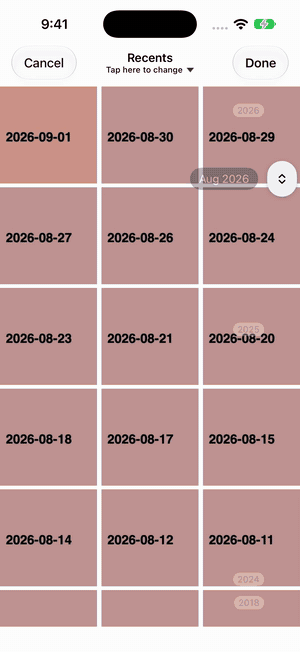
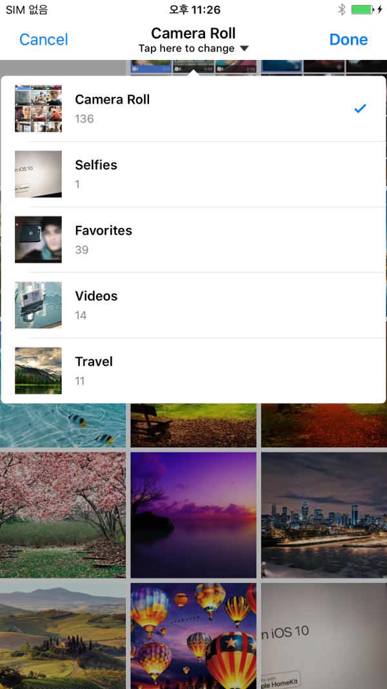

<p align="center">
  
</p>

<p align="center">
  <b>A customizable photo &amp; video picker for iOS — smart albums, selection order, live playback and date navigation.</b>
</p>

<p align="center">
  <a href="#installation"></a>
  <a href="https://cocoapods.org/pods/TLPhotoPicker"></a>
  
  
  <a href="LICENSE"></a>
  <a href="https://github.com/sponsors/tilltue"></a>
</p>

<p align="center">
  
  &nbsp;&nbsp;
  
</p>

## Contents

- [Why TLPhotoPicker](#why-tlphotopicker)
- [Features](#features)
- [Installation](#installation)
- [Quick Start](#quick-start) · [SwiftUI](#swiftui)
- [Date Navigation](#date-navigation) <sup>new in 2.2</sup>
- [Recipes](#recipes)
- [Example App](#example-app)
- [Documentation](#documentation)

## Why TLPhotoPicker

Apple's `PHPickerViewController` is the right choice when you only need to pick a few photos: it needs no
Photos permission and runs out of process. Reach for TLPhotoPicker when the picker is part of your product UI:

| | TLPhotoPicker | PHPickerViewController |
| --- | :---: | :---: |
| Custom cells, colors and layout | ✅ | — |
| Numbered selection order | ✅ | ✅ (iOS 15+) |
| Custom selection rules (`canSelectAsset`) | ✅ | — |
| Camera cell inside the grid | ✅ | — |
| Album switching | ✅ | ✅ |
| Open at a date, month scrubber | ✅ | — |
| Live updates when the library changes | ✅ | — |
| Works without Photos permission | — | ✅ |

## Features

- 🗂️ **Smart albums** — Camera roll, selfies, panoramas, favorites, videos and user albums
- 🔢 **Selection order** — Numbered badges and max-selection limits
- ▶️ **Playback** — Videos and Live Photos play right in the grid
- 📅 **Date navigation** — Open at a given day and scrub across months *(2.2)*
- 📷 **Camera cell** — Built-in or fully custom live camera cell
- 🎨 **Customizable** — Custom cells, presets, builder-style configuration
- 🔄 **Live updates** — Reloads when the Photos library changes
- ☁️ **iCloud** — Downloads iCloud assets with progress
- ⚡ **Async/await** — `fullResolutionImage()` and file export helpers on `TLPHAsset`

## Installation

### Swift Package Manager (recommended)

In Xcode: **File ▸ Add Package Dependencies…** and enter `https://github.com/tilltue/TLPhotoPicker.git`.

Or in `Package.swift`:

```swift
dependencies: [
    .package(url: "https://github.com/tilltue/TLPhotoPicker.git", from: "2.2.1")
]
```

### CocoaPods

```ruby
pod 'TLPhotoPicker'
```

> [!NOTE]
> The CocoaPods trunk becomes [read-only on December 2, 2026](https://blog.cocoapods.org/CocoaPods-Specs-Repo/).
> Existing versions keep resolving, but Swift Package Manager is the recommended way to stay up to date.

### Privacy keys

Add these to your `Info.plist`:

```xml
<key>NSPhotoLibraryUsageDescription</key>
<string>Access to photos is required to select images</string>
<key>NSCameraUsageDescription</key>
<string>Camera access is required to take photos</string>
```

> [!TIP]
> With limited photo access (iOS 14+), add `PHPhotoLibraryPreventAutomaticLimitedAccessAlert` = `YES` to stop the
> system prompt on every launch. The picker then shows its own button to manage the selection.
> [Learn more](https://developer.apple.com/videos/play/wwdc2020/10641/)

## Quick Start

```swift
import TLPhotoPicker

final class ViewController: UIViewController, TLPhotosPickerViewControllerDelegate {
    func openPicker() {
        let picker = TLPhotosPickerViewController()
        picker.delegate = self
        picker.configure = TLPhotosPickerConfigure()
            .numberOfColumns(3)
            .maxSelection(10)
        present(picker, animated: true)
    }

    func dismissPhotoPicker(withTLPHAssets: [TLPHAsset]) {
        Task {
            let images = await withTaskGroup(of: UIImage?.self) { group in
                withTLPHAssets.forEach { asset in group.addTask { await asset.fullResolutionImage() } }
                return await group.reduce(into: [UIImage]()) { if let image = $1 { $0.append(image) } }
            }
            // use images
        }
    }
}
```

Presets cover the common cases and can be extended with the builder methods:

```swift
picker.configure = .singlePhoto      // one photo, no video
picker.configure = .videoOnly        // videos only
picker.configure = .compactGrid      // 4 columns
picker.configure = .videoOnly.numberOfColumns(4).selectedColor(.systemBlue)
```

### SwiftUI

Wrap the picker with `UIViewControllerRepresentable` and present it with `fullScreenCover` or `sheet`.
The picker dismisses its own presentation, so `isPresented` returns to `false` automatically.

```swift
import SwiftUI
import TLPhotoPicker

struct PhotoPicker: UIViewControllerRepresentable {
    var configure = TLPhotosPickerConfigure()
    var onPick: ([TLPHAsset]) -> Void

    func makeUIViewController(context: Context) -> TLPhotosPickerViewController {
        let picker = TLPhotosPickerViewController()
        picker.configure = configure
        picker.delegate = context.coordinator
        return picker
    }

    func updateUIViewController(_ picker: TLPhotosPickerViewController, context: Context) {}

    func makeCoordinator() -> Coordinator { Coordinator(onPick: onPick) }

    final class Coordinator: NSObject, TLPhotosPickerViewControllerDelegate {
        let onPick: ([TLPHAsset]) -> Void
        init(onPick: @escaping ([TLPHAsset]) -> Void) { self.onPick = onPick }

        func dismissPhotoPicker(withTLPHAssets: [TLPHAsset]) {
            onPick(withTLPHAssets)
        }
    }
}

struct ContentView: View {
    @State private var showPicker = false
    @State private var assets: [TLPHAsset] = []

    var body: some View {
        Button("Choose Photos") { showPicker = true }
            .fullScreenCover(isPresented: $showPicker) {
                PhotoPicker(configure: .singlePhoto) { assets = $0 }
                    .ignoresSafeArea()
            }
    }
}
```

> [!IMPORTANT]
> Embedding the picker in SwiftUI requires **2.2.0** or later. Earlier versions also dismissed the screen underneath.

## Date Navigation

Open the picker at a given day — handy for diaries, journals and anything tied to a date — and let people drag a
scrubber on the trailing edge to jump across months.


```swift
var scrubber = TLDateScrubberConfigure()
scrubber.snapToMonth = true      // land on the first photo of each month
scrubber.showsYearMarks = true   // year marks along the track while dragging

picker.configure = TLPhotosPickerConfigure()
    .initialScrollDate(entryDate)   // open at this day (nearest older photo if the day is empty)
    .dateScrubber(scrubber)         // nil, the default, hides it

// Or jump at any time
picker.scrollTo(date: someDate, animated: true)
```

- Lookups are binary searches over the fetch result, so they stay fast on libraries with tens of thousands of photos.
- The bubble uses your locale (`"Mar 2025"`, `"2025년 3월"`) and fires a selection haptic on every month change.
- VoiceOver users get an adjustable control that moves one month per swipe.
- Requires a `creationDate` sort (the default). It is disabled with `groupByFetch`.

See the [Configuration Guide](Documentation/CONFIGURATION.md#date-navigation) for every option.

<br clear="right">

## Recipes

<details>
<summary><b>Custom selection rules</b></summary>

```swift
picker.canSelectAsset = { asset in
    asset.pixelWidth >= 300 && asset.pixelHeight >= 300
}
picker.didExceedMaximumNumberOfSelection = { picker in
    // show an alert
}
```
</details>

<details>
<summary><b>Video recording only</b></summary>

```swift
picker.configure = TLPhotosPickerConfigure()
    .mediaType(.video)
    .allowPhotograph(false)
    .allowVideoRecording(true)
```
</details>

<details>
<summary><b>Capture to a file URL instead of the Photo Library</b></summary>

```swift
picker.didCaptureMediaURL = { url in
    // The camera and the picker are already dismissed here; just present your next screen.
    presentingViewController.present(MyUploadViewController(fileURL: url), animated: true)
}
```

Captured media is returned as a temporary file instead of being saved to the Photo Library.
</details>

<details>
<summary><b>Custom cells and camera cell</b></summary>

| Smart Albums | Live Photo | Video | Photo | Custom Cell |
| --- | --- | --- | --- | --- |
|  |  |  |  |  |

```swift
picker.configure = TLPhotosPickerConfigure()
    .photoCellNib(name: "CustomCell_Instagram", bundle: .main)
    .cameraCellNib(name: "CustomCameraCell", bundle: .main)
```


See [Advanced Usage](Documentation/ADVANCED.md) for subclassing and custom data sources.
</details>

<details>
<summary><b>Delegate methods</b></summary>

All methods are optional.

```swift
protocol TLPhotosPickerViewControllerDelegate {
    func shouldDismissPhotoPicker(withTLPHAssets: [TLPHAsset]) -> Bool
    func dismissPhotoPicker(withTLPHAssets: [TLPHAsset])
    func dismissPhotoPicker(withPHAssets: [PHAsset])
    func photoPickerDidCancel()
    func dismissComplete()
    func canSelectAsset(phAsset: PHAsset) -> Bool
    func didExceedMaximumNumberOfSelection(picker: TLPhotosPickerViewController)
    func handleNoAlbumPermissions(picker: TLPhotosPickerViewController)
    func handleNoCameraPermissions(picker: TLPhotosPickerViewController)
}
```
</details>

<details>
<summary><b>Working with <code>TLPHAsset</code></b></summary>

```swift
let image = await asset.fullResolutionImage()

asset.cloudImageDownload(progressBlock: { progress in }, completionBlock: { image in })

asset.tempCopyMediaFile(convertLivePhotosToJPG: true) { url, mimeType in }

asset.photoSize { bytes in }
```

See the [API Reference](Documentation/API.md#tlphasset).
</details>

## Example App

```bash
cd Example && pod install && open TLPhotoPicker.xcworkspace
```

Run **TLPhotoPicker-Example** and try **with Date Navigation**. To fill a simulator with dated photos:

```bash
swift Scripts/seed-dated-photos.swift /tmp/tl-seed 24
xcrun simctl addmedia booted /tmp/tl-seed/*.jpg
```

## Documentation

- [Configuration Guide](Documentation/CONFIGURATION.md) — every option and preset
- [Advanced Usage](Documentation/ADVANCED.md) — custom cells, data sources, subclassing
- [API Reference](Documentation/API.md) — `TLPHAsset`, delegates, enums
- [Migration Guide](Documentation/MIGRATION.md) — upgrading from older versions

## Requirements

| TLPhotoPicker | iOS | Swift | Xcode |
| --- | --- | --- | --- |
| 2.2 | 15.0+ | 5.5+ | 14.0+ |
| 2.1 | 13.0+ | 5.0+ | 14.0+ |

## Contributing

Issues and pull requests are welcome. Please search existing issues first, and run the package tests by opening
`Package.swift` in Xcode and pressing **⌘U** on an iOS Simulator.

## Support

TLPhotoPicker is maintained in my free time. If it saves you time, consider
[sponsoring](https://github.com/sponsors/tilltue) — it goes into iOS compatibility updates, new features and docs. 🙏

## Author

**wade.hawk** — junhyi.park@gmail.com · Using TLPhotoPicker in your app? Let me know!

## License

MIT. See [LICENSE](LICENSE).
